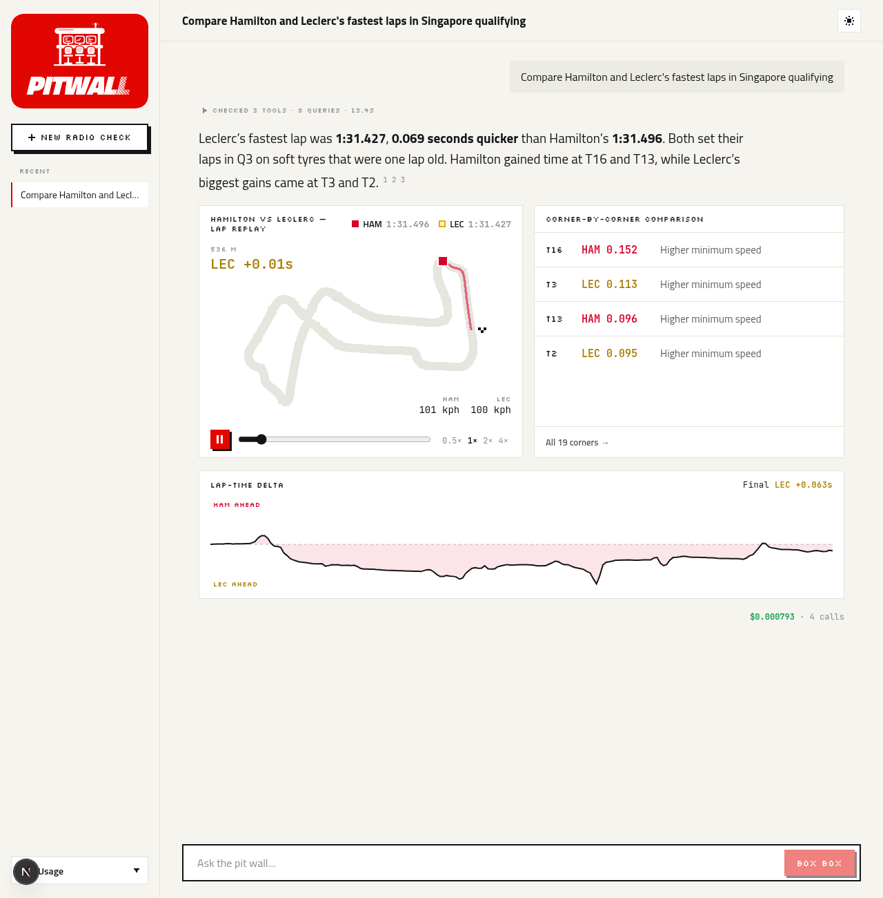
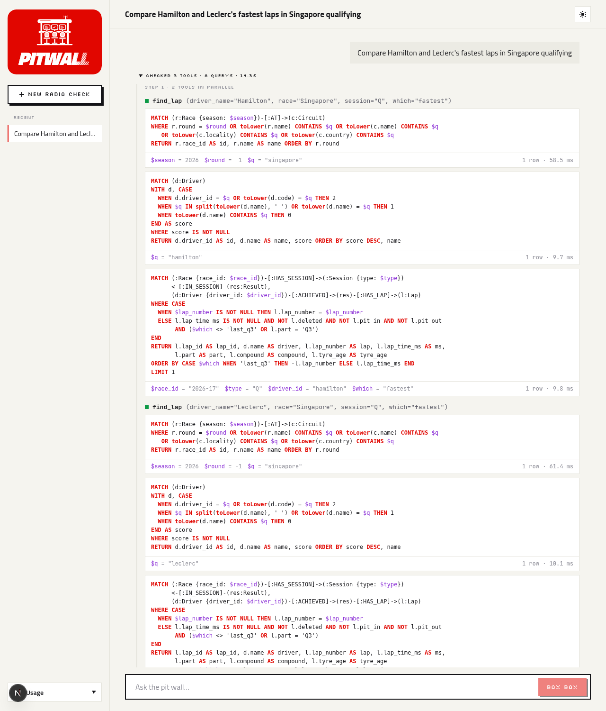

<p align="center">
  
</p>

<p align="center"><b>Your race engineer for the 2026 F1 season.</b><br>
An agent on a Neo4j knowledge graph and real telemetry. Every answer shows the Cypher it ran and what it cost.</p>

<p align="center">
  <a href="#run-it-locally">Run it</a> ·
  <a href="docs/architecture.md">Architecture</a> ·
  <a href="docs/deploy.md">Deploy</a> ·
  <a href="backend/evals/results">Eval results</a>
</p>

> Unofficial fan project. Not affiliated with Formula 1, the FIA or any team.



## What it does

- **Answers from a knowledge graph.** "What is Antonelli's qualifying head-to-head against Russell?" becomes Cypher on Neo4j. The answer cites the rows it came from.
- **Replays real laps.** "Compare Hamilton and Leclerc in Singapore qualifying" rebuilds both laps from OpenF1 telemetry: a pixel replay with a ghost car, the gap through the lap, and the corners where time was won.
- **Shows its work.** The trace lists every tool call and every Cypher query, with its parameters, row count and time. Each answer shows its LLM cost (about $0.0008 for a lap comparison).
- **Free to try.** Ask one question as a guest. Sign in with Google, GitHub or an email link for 30 a day. A daily spend cap in Postgres protects the LLM budget.
- **Runs on Telegram too.** The same agent answers in chat, and "Open lap replay" opens the replay as a Telegram Mini App.

## Architecture

```
  Web (Next.js, Vercel)          Telegram bot
        │ POST /ask (SSE)              │ webhook
        ▼                              ▼
  ┌──────────────── FastAPI (Render, Docker) ─────────────────┐
  │  rate limit · daily spend cap · CORS                      │
  │                                                           │
  │  LangGraph agent                                          │
  │   planner ──tool calls──▶ tools ──▶ planner … ──▶ composer │
  │   (gpt-6-luna, max 6 tool calls)        (typed blocks)    │
  │                                                           │
  │  tools: session_results · driver_season · standings ·     │
  │         teammate_battle · driver_teams · session_laps ·   │
  │         find_lap · compare_laps · run_cypher (guarded)    │
  └──────┬────────────────────┬────────────────────┬──────────┘
         ▼                    ▼                    ▼
   Neo4j (AuraDB)       Parquet + OpenF1     Postgres (Supabase)
   the graph            lap telemetry        agent memory, spend ledger
```

1. The **planner** reads the question and calls tools. Independent calls run in parallel.
2. Each tool runs **Cypher templates** on Neo4j. Telemetry tools also read lap telemetry.
3. The **composer** writes the answer as typed blocks: text, plus components such as `lap_replay`, `delta_chart`, `corner_table` and `results_table`. The model only names a tool result. Code fills the numbers, so a chart can never show a number the LLM invented.
4. The API streams it all as **Server-Sent Events**: `step`, `tool` (with its queries), `block`, then `done` with the token count and cost.

## How Neo4j is used

The graph holds the 2026 season: 28.8k nodes and 30.5k relationships.

```
(Driver)-[:ACHIEVED]->(Result)-[:IN_SESSION]->(Session {Q|S|R})<-[:HAS_SESSION]-(Race)-[:AT]->(Circuit)
(Result)-[:FOR_TEAM]->(Constructor)        (Result)-[:HAS_LAP]->(Lap)  ── lap_id ──▶ Parquet telemetry
(Driver)-[:HAS_STINT]->(Stint)-[:FOR_TEAM]->(Constructor)              derived: mid-season moves
(Driver)-[:TEAMMATE_OF {quali_h2h, race_h2h, avg_quali_gap_pct}]-(Driver)   derived: head-to-heads
```

- **Results are nodes, not relationship properties.** Laps, teams and later penalties all attach to a result.
- **Derived relationships** (`Stint`, `TEAMMATE_OF`) are rebuilt after each ingest. A head-to-head is one hop, not a scan of every session.
- **Entity resolution in Cypher.** "Lewis", "HAM" and "hamilton" all resolve to the same driver through a ranked match. If a name is ambiguous, the agent asks you which one you mean.
- **Templates first, Text2Cypher last.** Eight tools use tested templates. The `run_cypher` fallback has four guards: a denylist, an `EXPLAIN` check that the query only reads, a read-only transaction, and a 5 s / 200-row limit.

What one trace sends, for "Compare Hamilton and Leclerc's fastest laps in Singapore qualifying":

| Step | Tool | Cypher sent to Neo4j |
|---|---|---|
| 1 (parallel) | `find_lap` ×2 | find race (`$q="singapore"`) → find driver (`$q="hamilton"`, then `"leclerc"`) → `FIND_LAP` (`$race_id="2026-17"`, `$type="Q"`, `$which="fastest"`) |
| 2 | `compare_laps` | `LAP_FACTS` ×2 (`$lap_id`), then the telemetry comparison in Python |

That makes 8 queries, each between 10 and 60 ms. The web trace shows every one:



## Evals

| Suite | What it checks | Result |
|---|---|---|
| `pitwall-eval laps` | `find_lap` picks each driver's official best qualifying lap, 2026 R1–R17 | **99%** (198/200, both misses are [source-data gaps](docs/architecture.md#171-known-data-gaps)) |
| `pitwall-eval agent` | 8 golden questions: right tools called, right facts in the answer, right components | **8/8**: tools 100%, facts 100%, components 100% |
| Cost and latency | the same 8 questions, gpt-6-luna | $0.0038 total · p50 5.2 s · p95 9.2 s |

The evals run against the full graph, so they run locally (`backend/evals/results`). CI runs lint, 74 tests and the web build.

## Run it locally

```bash
docker compose up -d --wait                     # Neo4j + Postgres
cd backend && uv sync
uv run pitwall-ingest --season 2026             # results -> graph (about 1 min)
uv run pitwall-ingest-laps --season 2026        # laps + hot-set telemetry (about 70 min)
cp .env.example .env                            # set PITWALL_OPENAI_API_KEY
uv run uvicorn pitwall.api.main:app --reload    # http://localhost:8000/docs

cd ../web && npm install && npm run dev         # http://localhost:3000
```

The Telegram bot runs locally with `uv run python -m pitwall.telegram` once `PITWALL_TELEGRAM_BOT_TOKEN` is set.

## Stack

Python 3.12 · FastAPI · LangGraph · OpenAI gpt-6-luna · Neo4j 5 · Polars + Parquet · Postgres · Next.js 16 · React 19 · Telegram Bot API

## Data

Results from [Jolpica-F1](https://github.com/jolpica/jolpica-f1). Laps and telemetry from [OpenF1](https://openf1.org). Corner positions from MultiViewer.

## License

MIT
