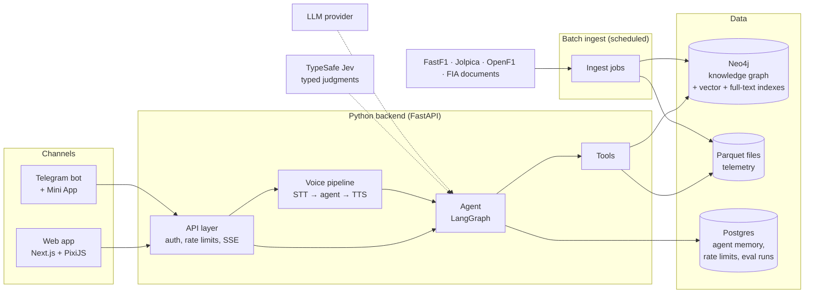
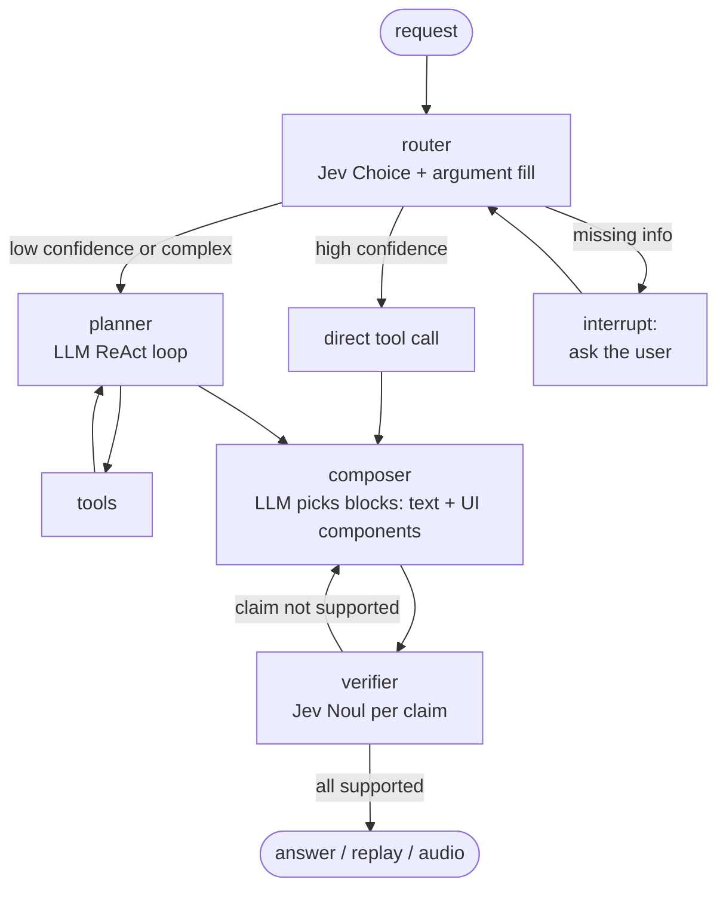

# Pit Wall: Architecture Plan

Status: v1.1 (2026-10-13), updated with the design decisions. Owner: Firas.
Writing style: ASD-STE100 Simplified Technical English. Short sentences. One idea per sentence.
Each technical term is **bold** where it first appears, with a plain definition. Interviewers will use these terms.

---

## 1. What Pit Wall does

Pit Wall is an unofficial F1 analysis agent. You ask a question in text or voice. Pit Wall answers with facts, charts, and lap replays.

Example requests:

- "Show me Lewis's last Q3 lap at Monza." → A pixel-art replay of that lap. Two AI commentators explain it.
- "Compare it with the pole lap." → A **ghost car** (a second car that shows the reference lap) and a live time gap.
- "Which circuit types suit Lewis best?" → An answer from the knowledge graph, with the method and the sources.
- "Which teams use the same power unit as the works team, and how do they compare?" → A graph answer.

Pit Wall has two **channels** (ways for a user to reach the system):

1. **Web app.** The full experience: replays, charts, graph views, and voice.
2. **Telegram bot.** Text and voice-note questions. Replays open in a **Telegram Mini App** (a web page that opens inside Telegram).

### 1.1 Scope

| Area | In scope | Out of scope |
|---|---|---|
| Sessions | Qualifying, Sprint, Race | Practice, Sprint Qualifying |
| Telemetry and replays | 2026 season to date. 2025 season as the test season. | Seasons before 2025 |
| Knowledge graph (results, teams, drivers, circuits) | 1950 to now | Car setup data (not public) |
| Documents | FIA stewards' decisions and sporting regulations, 2025–2026 | News articles |
| Commentary voice | Original voices and personas | Clones of real commentators' voices (no consent; this is not permitted) |

Pit Wall is unofficial and non-commercial. Do not use F1 logos or "Formula 1" in the product name.

---

## 2. System overview



The system has four parts:

1. **Channels.** The web app and the Telegram bot. They only show data and collect input. They contain no business logic.
2. **Backend.** One Python service. It contains the agent, the tools, and the voice pipeline.
3. **Data stores.** Three stores. Each store holds the data shape that it is best at (see ADR-002).
4. **Ingest.** Scheduled jobs. They get data from the sources, clean it, and write it to the stores.

**Term: ports and adapters (hexagonal architecture).** The core logic (the agent and tools) does not know which channel sent a request. Each channel has an **adapter**. The adapter converts the channel's format into one internal request format. You can add a new channel (for example, Discord) without a change to the core.

---

## 3. Data sources

| Source | Data | Access | Notes |
|---|---|---|---|
| **FastF1** (Python library) | Timing, telemetry, circuit corners | **Blocked since Oct 2026:** F1's timing archive returns 401 for all seasons (see ADR-008). Used only in the Phase 0 spike. | Kept for the spike script and circuit-corner data from its cache |
| **Jolpica-F1 API** | Results, qualifying, standings, drivers, constructors, circuits, 1950 to now | Free. Rate limit 4 req/s, 500 req/h. CSV dumps exist. | Successor to the Ergast API (shut down in 2025). Same format. |
| **OpenF1 API** | Laps, sectors, tyre stints, race control messages, car data (speed, throttle, brake, gear, RPM), location (x, y), team radio | Free tier: 3 req/s, **30 req/min**. Non-commercial use. | **Primary source for laps and telemetry** (ADR-008). Car data and location every approx. 240 ms. Same feed as FastF1: identical lap times and coordinates. |
| **MultiViewer API** | Corner numbers and x/y positions per circuit | Free, unofficial (the same source FastF1 uses for circuit info) | Used by `compare_laps` to name corners. Cached on disk per session. Corners land within 3 m of the racing line. |
| **FIA documents** | Stewards' decisions (PDF), sporting and technical regulations (PDF) | Public web pages | Fetch slowly. Store the source URL with each fact. |
| **Wikipedia / Wikidata** | Team lineage (which team became which), power-unit supply | Open licences | Curate. Store a source URL and a "last verified" date. |

**Risk: 2026 data shape.** The 2026 regulations removed DRS and added active aerodynamics. Some telemetry fields can be different or empty. Phase 0 (a one-day **spike**, a short test to remove uncertainty) checked what FastF1 and OpenF1 give for 2026. Result: the `DRS` channel is always 0 and there is no active-aero channel. See [the spike report](spikes/2026-telemetry.md).

---

## 4. Data stores

### 4.1 Neo4j: the knowledge graph

**Term: knowledge graph.** A database of **nodes** (things, for example a driver) and **relationships** (links between things, for example DROVE_FOR). Both nodes and relationships can have **properties** (key-value data). A graph is good for questions that follow many links (**multi-hop** questions).

**Term: property graph model.** Neo4j's data model: nodes have **labels** (types), relationships have a **type** and a direction, and both have properties. The query language is **Cypher**.

#### Graph model (v1)

```
                                ┌──────────── :FOR_TEAM ────────────┐   ← source of truth
                                │                                   ▼
(Driver)──:ACHIEVED──▶( Result )──:IN_SESSION──▶(Session {Q|S|R})  (Constructor)
   │                   position, grid,                ▲                  ▲
   │                   points, q1/q2/q3,              │ :HAS_SESSION     │ :FOR_TEAM
   │                   gap_to_teammate_pct          (Race)──:AT──▶(Circuit)
   │                      │                                      │
   │                      └──:HAS_LAP──▶(Lap {lap_id, lap_time,  └─:HAS_TRAIT {score}─▶(CircuitTrait)
   │                                         s1, s2, s3, compound, tyre_age,
   │                                         part, is_personal_best, deleted, pit_in, pit_out})
   │                                           └── lap_id = shared key ──▶ Parquet samples
   ├──:HAS_STINT──▶(Stint {season, from_round, to_round})──:FOR_TEAM──▶(Constructor)   ← derived
   │
   └──[:TEAMMATE_OF {season, team, quali_h2h:[a,b], race_h2h:[a,b],
                     sprint_h2h:[a,b], avg_quali_gap_pct}]──(Driver) ← derived, one per pair
```

```
(:Driver {driver_id, name, code, nationality, dob})
(:Constructor {constructor_id, name})                  // one team identity, for example "Brawn GP"
(:Circuit {circuit_id, name, country, length_km})
(:CircuitTrait {name})                                  // "high-speed", "street", "heavy-braking"
(:Race {race_id, season, round, name, date})
(:Session {session_id, type})                           // Q, S, R
(:Result {result_id, position, grid, points, status, q1, q2, q3, gap_to_teammate_pct})
(:Lap {lap_id, driver_number, started_at, lap_time_ms, s1_ms, s2_ms, s3_ms, compound, tyre_age,
      fresh_tyre, tyre_stint, part, is_personal_best, deleted, deleted_reason, pit_in, pit_out,
      speed_trap_kph})   // deleted = track limits etc.; only push laps are pre-rendered
(:Stint {season, from_round, to_round})                 // derived from Results
(:Manufacturer {name})                                  // power-unit or parts supplier (later)
(:Incident {incident_id, lap, description})             // later
(:Decision {doc_id, penalty, date})                     // a stewards' decision (later)
(:RegArticle {code, title})                             // a regulation article (later)
(:Chunk {text, embedding})                              // a part of a document, for vector search (later)
(:Source {url, title, retrieved_at})

(:Driver)-[:ACHIEVED]->(:Result)-[:IN_SESSION]->(:Session)
(:Result)-[:FOR_TEAM]->(:Constructor)                               // source of truth for team membership
(:Result)-[:HAS_LAP]->(:Lap)
(:Driver)-[:HAS_STINT]->(:Stint)-[:FOR_TEAM]->(:Constructor)        // derived
(:Driver)-[:TEAMMATE_OF {season, team, quali_h2h, race_h2h, sprint_h2h,
                         avg_quali_gap_pct, sessions_together}]->(:Driver)   // derived
(:Constructor)-[:BECAME {year}]->(:Constructor)                     // team lineage
(:Manufacturer)-[:SUPPLIED {component, season}]->(:Constructor)
(:Race)-[:AT]->(:Circuit)-[:HAS_TRAIT {score}]->(:CircuitTrait)
(:Race)-[:HAS_SESSION]->(:Session)
(:Driver)-[:INVOLVED_IN]->(:Incident)<-[:ABOUT]-(:Decision)-[:CITES]->(:RegArticle)
(:Decision)-[:HAS_CHUNK]->(:Chunk)
(any fact node)-[:SOURCED_FROM]->(:Source)
```

Design choices in this model (interviewers ask about these):

- **Intermediate node (reification).** A result is a `Result` node, not only properties on a relationship. Reason: penalties, stewards' decisions, laps, and sources must link to a result. A relationship cannot be the target of another relationship. A node can.
- **Team on each result.** Team membership is a fact at race level. A season is too coarse: drivers change teams mid-season (2025: Lawson and Tsunoda after round 2). `Result -[:FOR_TEAM]->` is the source of truth. `Stint` nodes are derived from it.
- **Derived relationships.** `Stint` and `TEAMMATE_OF` are calculated after each ingest. They are **denormalizations** (stored data that you could calculate again). You can delete and rebuild them at any time, so they cannot drift from the facts.
- **Symmetric relationship.** `TEAMMATE_OF` means the same in both directions. Store one copy per pair, from the lower `driver_id` to the higher. Match it without direction: `-[:TEAMMATE_OF]-`. In the `[a, b]` arrays, index 0 is the start node. `avg_quali_gap_pct` is signed from the start node's side (negative = start node faster). Race and sprint head-to-heads count only sessions where both cars were classified.
- **Lap summaries in the graph, samples in Parquet.** A `Lap` node has approx. 10 values. Its telemetry samples (hundreds of rows) stay in Parquet. `lap_id` (`season-round-session-driver-lap`) is a **natural key** that both stores share. The tools join them in code (**application-level join**).
- **Temporal properties.** `SUPPLIED {season}` and `BECAME {year}` record *when* a fact was true. Without time, the graph gives wrong answers for history questions.
- **Supernode risk.** A **supernode** is a node with very many relationships (for example, one `Season` node linked to every result). Traversals through a supernode are slow. There is no `Season` node. Results link to `Session` (approx. 20 per session). Laps link to their `Result` (max approx. 70), not to the `Session` (approx. 1,200).
- **Provenance.** Curated facts (lineage, supply) have a `SOURCED_FROM` link. The agent can show the source for each fact. This continues the provenance idea from Misbah.

#### Indexes in Neo4j

- **Uniqueness constraints** on IDs (`driver_id`, `race_id`, ...). They also make **idempotent upserts** possible (see section 7).
- **Vector index** on `Chunk.embedding`. **Term: vector index.** An index for **approximate nearest neighbour (ANN)** search over **embeddings** (number lists that represent meaning). Neo4j uses **HNSW** for this (the same algorithm as in Misbah).
- **Full-text index** on `Chunk.text`. **Term: full-text index.** A keyword index (Lucene, **BM25** ranking). It finds exact words, for example a regulation code "Article 33.4". Vectors are weak at this.

### 4.2 Parquet files: telemetry

Telemetry is **time-series data** (many samples per lap, ordered by time). One lap has hundreds of samples. One session has thousands of laps × channels.

Pit Wall does **not** keep telemetry in Neo4j. It keeps telemetry in **Parquet** files.

**Term: Parquet.** A **columnar** file format. It stores each column together and compresses it well. It is fast for analysis of a few columns over many rows.

**Term: DuckDB / Polars.** Tools that query Parquet files directly, with SQL (DuckDB) or a DataFrame API (Polars). No database server is necessary.

File layout: **one file per lap**, `telemetry/{season}/{round}/{session}/{driver_id}/{lap}.parquet`. Parquet files cannot be appended to, so one file per lap avoids rewrites. Writes are atomic (write a temp file, then rename). At very large scale this becomes the **small-files problem**; at a few thousand laps it is the simplest correct choice.

### 4.3 Postgres: application state

Postgres keeps:

- **Agent memory**: the LangGraph **checkpointer** (see section 6). One **thread** per Telegram chat or web session.
- Rate-limit counters (the same pattern as Misbah).
- Eval runs and their scores.

You can use Supabase for this Postgres. You already know its tools.

---

## 5. Backend (Python)

| Concern | Choice | Reason |
|---|---|---|
| Language and runtime | Python 3.12+ | FastF1, neo4j-graphrag, and LangGraph are Python-first |
| Package manager | **uv** | Fast. One lock file. |
| Web framework | **FastAPI** | Async. Automatic **OpenAPI** schema. Good **SSE** support. |
| Data validation | **Pydantic v2** | Typed models for requests, tool inputs, and LLM **structured output** |
| Agent framework | **LangGraph** | Explicit state machine, checkpointing, streaming (see ADR-003) |
| Graph access | Official `neo4j` driver + **`neo4j-graphrag`** | Ready retrievers: Vector, Hybrid, VectorCypher, Text2Cypher |
| Telemetry analysis | OpenF1 + NumPy + Polars (DuckDB later) | |
| Telegram | **aiogram** (async) in **webhook** mode | Webhook: Telegram calls your server. Better than **long polling** in production. |
| Background jobs | A worker process with a scheduler (APScheduler or cron) | Ingest after each session |

**Term: SSE (Server-Sent Events).** One-way streaming from server to browser over HTTP. The backend uses SSE to stream agent steps and answer tokens. It is simpler than **WebSockets** when the client does not need to stream data back. Voice uses WebSockets because audio goes in both directions.

---

## 6. The agent (LangGraph)

### 6.1 LangGraph terms

- **StateGraph.** A graph of steps. Each step is a **node** (a Python function). Each node reads the shared **state** and returns an update.
- **State.** A typed object (TypedDict or Pydantic). It holds the messages, the detected intent, tool results, citations, and checks.
- **Reducer.** A rule that merges a node's update into the state. Example: append new messages, do not replace them.
- **Edge / conditional edge.** An edge sets the next node. A conditional edge selects the next node from the state.
- **Checkpointer.** Saves the state after each step, in Postgres. This gives conversation memory, recovery after a failure, and **time travel** (replay from an old step).
- **Thread.** One saved conversation. Key: Telegram chat ID or web session ID.
- **ToolNode / tool calling.** The LLM selects a tool and its arguments. The tool node runs it.
- **ReAct.** A loop: the model reasons, calls a tool, reads the result, and repeats.
- **Interrupt (human-in-the-loop).** The graph stops and asks the user a question. It continues after the answer.
- **Subgraph.** A graph used as one node inside a bigger graph.
- **Streaming modes.** LangGraph can stream state updates, LLM tokens, or custom events.

### 6.2 Agent graph



**As built (deliverable 3).** `planner ⇄ tools → composer → END` in `agent/graph.py`. Router and verifier come in v1.1.

- **Hard tool budget.** After 6 tool results in one turn, the planner is called with `tool_choice="none"`. Code enforces the limit, not the prompt.
- **Tool errors are messages.** `ToolNode(handle_tool_errors=True)` returns an error as a tool message, so the planner can fix a Cypher query or ask about an ambiguous name.
- **Sources are per turn.** The composer gets only this turn's question, findings and tool results (`r1`, `r2`, ...). Old turns stay out: this is cheaper, and the composer cannot cite stale data.
- **Memory.** The Postgres checkpointer (`AsyncPostgresSaver`) saves the state after each step, keyed by `thread_id`. The planner sees the last 4 user turns.

**Build order.** The MVP uses the LLM planner for all requests (simple, one path). v1.1 adds the Jev router fast path. The eval compares latency and accuracy before and after, so the README shows a measured improvement.

1. **Router (v1.1).** Jev selects the intent (for example `replay_lap`, `compare_laps`, `graph_question`, `doc_question`, `chitchat`) and fills the arguments (driver, race, session). This is fast. Voice needs fast first steps.
2. **Confidence gate.** If Jev's confidence is high, the system calls the tool directly. No LLM call is necessary. If confidence is low, or the request needs many steps, the LLM **planner** takes control. If an argument is missing ("which race?"), the graph uses an **interrupt** to ask the user.
3. **Planner.** An LLM with tool calling, in a ReAct loop. It has a limit: maximum 6 tool calls per request. This prevents loops and cost spikes.
4. **Composer.** An LLM builds a **hybrid answer**: a list of text blocks and UI components (section 6.4). Each fact has a citation to a tool result or a source.
5. **Verifier.** Jev checks each claim against the tool results (Noul: "Is this claim supported by this evidence?"). An unsupported claim goes back to the composer one time. If it fails again, the system removes the claim.

**Principle: code owns facts, Jev owns quick typed judgments, the LLM owns language.** Numbers come from code (FastF1, Cypher). The LLM never calculates a lap delta. It only describes the result.

### 6.3 Tools

Built in deliverable 3 (`backend/src/pitwall/agent/tools/`). Names, races and drivers in tool inputs are free text. Code resolves them to IDs (**entity resolution**): an exact code or ID beats a whole word of the name, which beats a substring ("VER" is Verstappen, not Oli*ver* Bearman). An ambiguous name returns an error that tells the planner to ask the user.

| Tool | Input | Output (`kind`) | Store |
|---|---|---|---|
| `session_results` | race, session | classification (`rows`) | Neo4j template |
| `driver_season` | driver, session | result per round (`rows`) | Neo4j template |
| `standings` | by driver or team | points and wins (`rows`) | Neo4j template |
| `teammate_battle` | driver | head-to-heads from the driver's side (`h2h`) | Neo4j template |
| `driver_teams` | driver | stints with round ranges (`stints`) | Neo4j template |
| `session_laps` | race, session, driver?, compound?, fastest or deleted | up to 25 laps (`rows`) | Neo4j template |
| `run_cypher` | one Cypher query | up to 200 rows (`rows`) | Neo4j, guarded (section 8.1) |
| `find_lap` | driver, race, session, fastest / last Q3 / lap N | lap ID and official time (`lap`) | Neo4j |
| `compare_laps` | two lap IDs | gap trace and gain per corner with cause (`lap_compare`) | Parquet + corners |

**Content and artifact.** Each tool returns two things: short **content** for the LLM, and the full **artifact** for the UI. The LLM never sees the artifact. Components are filled from it (data by reference, section 6.4).

**Official times for facts.** `compare_laps` takes lap times from the graph (official timing). Telemetry is approx. 0.1 to 0.2 s short (section 17.1), so it is used only for the shape of the gap and the corner split.

Later: `search_documents` (stewards' decisions, hybrid search + graph expansion), `team_radio`, `track_fit`.

### 6.4 Answer format: Intelligent UI (hybrid answers)

An answer is not only text. The composer picks the **best format for the question**: text, a component, or a mix. This is the same idea as ChatGPT's **Intelligent UI** (Oct 2026). The model chooses from a **fixed library of native components**. It never writes HTML or code.

```
question: "Hamilton vs Leclerc, last Q3 lap in Singapore?"

composer output (typed JSON, streamed block by block)
┌──────────────────────────────────────────────────────────┐
│ text        "Leclerc was 0.21 s faster. He lost 0.08 s   │
│              in T7 but gained it back in the last sector."│
│ lap_replay  laps: [ham-21, lec-19]   ghost: true          │
│ delta_chart source: tool#2 (corner_analysis)              │
│ corner_table source: tool#2   top: 3                      │
│ chips       ["Show their Q2 laps", "Who was faster in R?"]│
└──────────────────────────────────────────────────────────┘
        │ SSE: one event per block, then done {usage: tokens, usd}
        ▼
web: component registry  ──▶  PixiJS replay, uPlot chart, table, buttons
telegram: text fallback  ──▶  message + inline buttons + "Open replay" (Mini App)
```

**Terms**

- **Hybrid answer.** An answer that mixes text and interactive components in one reply.
- **Generative UI.** The model decides which UI to show at run time, instead of the developer fixing one layout per screen.
- **Component catalog (registry).** The fixed list of components that the model can use. Each has a typed schema (Pydantic on the backend, TypeScript types on the frontend). The model can only fill these schemas, so its output is safe and always renders.
- **Server-driven UI.** The backend sends a description of the UI (JSON). The client maps each block `type` to a real component.
- **Data by reference.** A component names a tool result (`source: tool#2`). The backend fills the numbers from that result. The LLM never types numbers into a chart. This keeps the rule *code owns facts* (section 6.2).
- **Graceful degradation.** Each component has a plain-text fallback. Telegram and voice get the fallback; the web gets the full component.

**Component catalog (MVP)**

| `type` | Shows | Filled from | Renderer |
|---|---|---|---|
| `text` | Short answer with citations | LLM (facts cited) | Markdown |
| `lap_replay` | Pixel-art lap replay, optional ghost car | `build_replay` | PixiJS |
| `delta_chart` | Time gap between two laps over distance | `corner_analysis` | uPlot |
| `corner_table` | Time gained or lost per corner, with cause | `corner_analysis` | Table |
| `results_table` | Session classification, or any rows | `graph_template`, `graph_query` | Table |
| `h2h_card` | Teammate battle: quali, race, sprint, average gap | `graph_template` | Card |
| `stint_timeline` | A driver's teams across the season | `graph_template` | Timeline |
| `graph_path` | The graph path behind an answer (the "why") | Cypher result paths | Sigma.js / NVL |
| `chips` | Follow-up questions, or the choices for a clarifying question ("which race?") | LLM | Buttons |

**Rules**

1. Text first, and short. Components carry the detail.
2. Use a component only if a tool result fills it. No result, no component.
3. Maximum 4 components per answer.
4. A simple fact question ("Who won in Monza?") gets text only. The model must not add UI that does not help.
5. The agent trace panel (section 12) stays separate from the answer. It shows how the answer was made.

---

## 7. Ingest pipeline

Ingest runs after each session and on demand.

1. **Extract.** Get data from FastF1, Jolpica, OpenF1, and FIA documents.
2. **Transform.** Clean names. Map each source ID to one canonical ID (**entity resolution**, see below). Calculate derived data (teammate head-to-heads, laps resampled for replays).
3. **Load.** Write Parquet files. Write the graph with Cypher `MERGE`.

### 7.1 Loading strategy: eager graph, hot-set telemetry, lazy rest

| Data | Size per season | Rule |
|---|---|---|
| Results, grid, qualifying times, laps (summaries) | Small | **Eager**: load all after each Q, Sprint, and Race. A partial graph gives wrong answers. |
| Telemetry, **hot set**: each driver's best push lap per Q part + last Q3 push lap; fastest push lap per driver in sprints and races. Push lap = timed, not deleted, not an out-lap or in-lap. | Approx. 1,700 laps | **Eager**: save to Parquet after each session |
| All other telemetry | Approx. 24,000+ laps | **Lazy**: load on the first request, then keep (laps never change) |

**Term: cache-aside.** The tool checks the cache (Parquet). On a miss, it loads the data and stores it.
**Term: cold-start latency.** The delay of the first request when the cache is empty. The UI shows a loader.

**Cache stampede protection.** Two requests can ask for the same uncached session at the same time. Without protection, both download it.

1. **Single-flight** in each process: one `asyncio.Task` per session key. Other requests wait for the same task.
2. **Postgres advisory lock** between processes: `pg_advisory_xact_lock(hash(session_key))`. The lock is released when the transaction ends, also after a crash.
3. **Double-checked locking:** after the lock, check the cache again.
4. Run FastF1 with `asyncio.to_thread`, because it is blocking code. It must not stop the event loop.

### 7.2 Steps

**Term: idempotent.** You can run the same job two times and get the same result, with no duplicates. Cypher `MERGE` plus uniqueness constraints make the graph writes idempotent. This fixes a problem from Misbah: its ingest script used `insert` and made duplicates when it ran again.

**Term: entity resolution.** The process that decides if two names are the same thing. Examples: "Mercedes-AMG Petronas F1 Team" and `mercedes`. "Brawn GP" and the team that became Mercedes. Pit Wall does this in three steps:

1. Exact ID match in code (most cases).
2. Fuzzy match on names to get candidates.
3. Jev selects the correct candidate, or "no match" (the TypeSafe **entity alignment** cookbook). Low-confidence cases go to a review file for a person.

**Documents (FIA PDFs).** Extract text. Split into chunks by section (**structure-aware chunking**, not fixed-size chunks). Calculate embeddings. Link each chunk to its `Decision`, its `Incident`, and the drivers involved.

---

## 8. Retrieval: GraphRAG in Pit Wall

**Term: RAG (retrieval-augmented generation).** The system first finds relevant data. Then the LLM writes an answer from that data. This reduces **hallucination** (invented facts).

**Term: GraphRAG.** This word has two meanings. Know both:

1. **Microsoft GraphRAG (the 2024 paper).** An LLM extracts a graph from unstructured text. An algorithm finds **communities** (groups of linked nodes). An LLM writes summaries of the communities. The system answers **global questions** ("what are the main themes?") from these summaries.
2. **Graph-backed RAG.** The system retrieves from a knowledge graph with queries and traversals.

Pit Wall uses meaning 2. Reason: the F1 data is already structured (results, teams, drivers). An LLM-built graph adds cost and errors here. Pit Wall uses LLM extraction only for the FIA documents.

Pit Wall has four retrieval strategies. The agent selects one or more:

| Strategy | Use it for | How it works |
|---|---|---|
| **Text2Cypher** | Open structured questions ("drivers who were teammates of both X and Y") | The LLM writes Cypher from the schema and **few-shot examples** (example questions with correct queries) |
| **Cypher templates** | Frequent questions (head-to-head, lineage, supply) | Fixed, tested queries. The router fills the parameters. Safer and faster than Text2Cypher. |
| **Hybrid search** | Document questions ("why did he get a penalty?") | Full-text (BM25) + vector search. Merge the two lists with **Reciprocal Rank Fusion (RRF)**. Then **rerank** with Jev. |
| **Vector + graph expansion** (VectorCypher) | Document questions that need context | Find chunks with vectors. Then follow graph links to the incident, drivers, and the regulation article. |

### 8.1 Text2Cypher safety

Text2Cypher lets an LLM write database queries. LLM output is **untrusted input**, so Pit Wall uses **defence in depth** (several independent layers):

```
LLM-written Cypher
   │
   ├─1─ denylist (regex)        LOAD CSV, CALL <procedure>, apoc.*, PROFILE, EXPLAIN  → refuse
   ├─2─ EXPLAIN → query_type    anything but 'r' (read) → refuse          (nothing runs yet)
   ├─3─ read transaction        the server itself rejects any write (AccessMode error)
   └─4─ limits                  5 s timeout, max 200 rows
          │
          └─ error? → back to the planner as a tool message → it can fix and retry
```

- **Why a denylist as well?** `EXPLAIN` reports `LOAD CSV FROM 'http://…'` and `CALL apoc.…` as **reads**. They can still fetch files or URLs (**SSRF**: server-side request forgery). Tested in `tests/test_graph_query.py`.
- **No read-only database user.** Neo4j Community has no role-based access control (an Enterprise feature). The read transaction (layer 3) gives the same protection for writes.
- **Retries.** The tool budget (max 6 tool calls per question, section 6.2) bounds retries. There is no separate retry counter.
- Log every generated query. Use bad queries as new few-shot examples (with the evals, deliverable 6).

### 8.2 "Which track suits which driver?" (the method)

A driver's raw result depends mostly on the car. To remove the car effect, compare each driver with their **teammate** (same car):

1. For each race, calculate the qualifying gap to the teammate (percent of lap time).
2. Group the gaps by circuit trait (high-speed, street, heavy braking, and so on).
3. A trait where the driver beats the teammate more than usual "suits" the driver.

Jev gives each circuit a **Score** per trait, from a text description of the circuit. These scores are features. Code does the statistics.

**Term: confounding variable.** A hidden cause that affects the result (here: car performance). Teammate normalization controls for it. Interviewers like this point.

---

## 9. Lap replay

### 9.1 Replay package (backend)

The backend builds a **replay package** for a lap:

1. Load the location (x, y) and car data (speed, throttle, brake, gear, RPM) for the lap window from OpenF1. Interpolate location onto the car-data timestamps (the two streams are sampled at different moments). Integrate speed over time for distance (trapezoid rule).
2. **Resample** to a fixed **distance step** (for example every 5 m). Raw samples have uneven time gaps.
3. Calculate events: brake points, apex minimum speeds, top speed, gear changes.
4. Add the track outline and the corner numbers (FastF1 circuit info).
5. Store the package as compressed JSON (or Arrow). Cache it. A lap never changes after the session.

**Term: distance-based alignment.** To compare two laps, match the samples by distance along the lap, not by time. Then "delta time" at each point is the time difference at the same place on the track.

### 9.2 Replay view (frontend)

- **PixiJS** (WebGL 2D renderer) draws the pixel-art car and track at 60 frames per second.
- The frontend **interpolates** between samples. A car at 300 km/h moves approx. 20 m between raw samples. Without interpolation, the car jumps.
- Pixel style: draw at low resolution. Scale up with **nearest-neighbour** filtering (sharp pixels, no blur).
- HUD: speed, gear, RPM, throttle and brake bars, delta to ghost, corner number. No DRS or aero (not in the 2026 feed).
- Telemetry charts under the replay: **uPlot** (very fast for large time series).

**Accuracy statement.** This is a replay rebuilt from real telemetry. It is not a physics simulation. Position data has an error of some metres. Say this in the UI.

---

## 10. Commentary and voice

### 10.1 Commentary for a replay

Two original personas, like a real broadcast:

- **Play-by-play**: high energy. Describes the action.
- **Analyst**: calm and technical. Explains the reason.

Pipeline:

1. **Events (code).** The replay package has the events list (brake points, deltas, top speed).
2. **Script (LLM).** The LLM writes lines as **structured output**: `{speaker, at_distance_m, text, facts_used[]}`.
3. **Check (Jev).** For each line: "Do these facts support this text?" (Noul). Lines that fail are removed or written again.
4. **Speech (TTS).** Each line becomes audio with the speaker's voice.
5. **Sync.** The player starts each audio line when the replay reaches `at_distance_m`.
6. **Cache.** Commentary for a lap is generated one time and stored.

### 10.2 Voice questions

**Term: cascaded pipeline** = **STT** (speech-to-text) → agent → **TTS** (text-to-speech).
**Term: speech-to-speech (S2S) model** = one realtime model takes audio in and gives audio out.

Pit Wall uses a **cascaded pipeline** (ADR-005). The agent must call tools and the verifier must check claims *before* speech. That is easy in a cascade and hard in S2S.

Voice terms:

- **VAD (voice activity detection).** Finds when the user starts and stops talking.
- **Barge-in.** The user talks while the system talks. The system stops its audio and listens.
- **TTFA (time to first audio).** Time from the end of the user's speech to the first sound of the answer. Target: under 1.5 s for simple requests (Jev fast path).
- **Streaming TTS.** The system starts speech before the full answer text is ready.

Telegram: the user sends a voice note (OGG/Opus). The bot transcribes it, runs the agent, and replies with text and a voice note.

---

## 11. Where Jev (TypeSafe) is used

Jev is a **System One** model. It does not generate text. It returns typed answers with **calibrated probabilities**: **Choice** (select one option), **Noul** (probability that a condition is true), **Score** (position on a scale). Text input only.

| Place | Primitive | Why Jev and not an LLM |
|---|---|---|
| Router | Choice + argument fill | Fast and typed. The confidence value drives the fast path or the planner. |
| Commentary and answer verification | Noul per claim | A cheap check on each claim before the user sees or hears it |
| Document reranking | Score per chunk | Better order of retrieved chunks |
| Entity resolution | Choice over candidates, with "no match" | Typed decision with a confidence for review |
| Circuit traits | Score per trait | Gives numeric features from text |

Rule: set confidence **thresholds** from eval data, not by guessing. Jev's docs do not give latency or prices. Measure them in Phase 0.

---

## 12. Frontend

| Concern | Choice | Reason |
|---|---|---|
| Framework | **Next.js** (TypeScript) | You know it. Good on Vercel. |
| Replay renderer | **PixiJS** | WebGL. Fast 2D sprites. Good for pixel art. |
| Charts | **uPlot** | Handles many points. Small. |
| Graph view | **Sigma.js** or Neo4j **NVL** | Shows the "why" path of a graph answer |
| Streaming | SSE client for agent steps; WebSocket for voice | |
| Style | Pit-wall / timing-screen look: dark background, monospace and pixel fonts, team colours, sector colours (purple, green, yellow) | Familiar to F1 tech people |

The visual direction will come from the `/frontend-design` step.

The **agent trace panel** shows each agent step live: router decision and confidence, tool calls, Cypher text, sources. This shows the engineering to a technical viewer.

---

## 13. Evals

**Term: eval (evaluation).** A repeatable test that measures quality. For AI systems, it measures answers, not only code.

**Term: golden dataset.** A fixed set of inputs with correct outputs. It is the reference for evals.

**Term: frozen season.** The 2025 season does not change. Its evals give the same score every time. CI uses 2025. The 2026 evals run on a schedule.

| Layer | What it measures | Method | Gate in CI |
|---|---|---|---|
| Data | Sector times, lap times from telemetry | Unit tests against official timing (tolerance) | Yes |
| Lap selection | `find_lap` picks the correct lap | Exact match, every 2025 race | Yes |
| Router (Jev) | Intent and argument accuracy, calibration | Labelled set of 200 requests. **Accuracy**, **expected calibration error (ECE)** | Yes |
| Graph Q&A | Correct answer | 150 questions, generated from Jolpica data + hand-written multi-hop. Compare result rows (**execution accuracy**), not Cypher text. | Yes |
| Retrieval ablation | Value of each strategy | Same questions: vector-only vs Text2Cypher vs hybrid vs all. Report in the README. | Report |
| Documents | Retrieval quality | **Recall@k**, **MRR** (mean reciprocal rank) on labelled questions | Report |
| Agent | Correct tools and arguments | **Trajectory eval**: compare tool calls with expected calls | Yes |
| Faithfulness | Unsupported claims in answers and commentary | Split into claims. Check each claim against evidence. **Hallucination rate** | Yes (threshold) |
| Voice | TTFA, STT errors on driver names | Recorded clips. **Word error rate (WER)** | Report |
| Prediction | Predicted vs actual qualifying order | **Spearman rank correlation** on unseen 2025 races (**backtest**) | Report |
| Cost and latency | Cost per request, p50/p95 latency | Traces | Report |

**Term: p95 latency.** 95% of requests are faster than this value. It shows the slow cases that an average hides.

**Term: LLM-as-judge.** An LLM grades another LLM's answer. Use it only where no exact check exists. Check the judge against human labels first.

Tools: **pytest** for the test runner. **Langfuse** (or LangSmith) for **traces** (a record of each step, input, output, time, and cost) and datasets. Results are stored in Postgres and shown on an eval page.

---

## 14. Deployment

| Part | Where | Reason |
|---|---|---|
| Frontend | Vercel | Free tier. You know it. |
| Backend, worker, Telegram webhook, Neo4j, Postgres | One small VPS (4 GB RAM) with **Docker Compose** | Low cost. Neo4j needs memory. No pause or deletion rules. |
| Telemetry Parquet files | VPS disk, backup to object storage (Cloudflare R2) | |
| Alternative for Neo4j | **AuraDB Free** | Managed. But it pauses after 72 h with no queries and deletes after 30 days paused. A daily keep-alive job is necessary. |

CI/CD: GitHub Actions. Steps: lint (**ruff**), types (**mypy** or **pyright**), tests, evals on the 2025 golden set, then deploy.

---

## 15. Security and cost control

- **Rate limits** per Telegram user ID and per IP (same pattern as Misbah).
- **Budget limits**: maximum tool calls per request, maximum tokens per request, daily cost cap.
- **Read-only database user** for Text2Cypher.
- **Prompt injection.** FIA document text and team radio text are data, not instructions. The system prompt says this. Tool outputs go into a separate, marked part of the prompt.
- **Secrets** stay on the server. The browser never gets an LLM key.
- **Caching**: replay packages, commentary audio, and frequent graph answers. A lap does not change after the session.

---

## 16. Architecture Decision Records (ADRs)

**Term: ADR.** A short record of one design decision: context, decision, alternatives, consequences.

### ADR-001: Python backend, TypeScript frontend
- **Context.** The data and graph tools are Python-first. The UI needs fast 2D rendering.
- **Decision.** FastAPI backend in Python. Next.js frontend in TypeScript.
- **Alternatives.** Full TypeScript (LangGraph.js): fewer languages, but no FastF1 and a weaker neo4j-graphrag. Full Python (Streamlit): fast to build, but not good enough for a pixel-art replay.
- **Consequences.** Two languages. The API contract must be clear. Generate TypeScript types from the OpenAPI schema.

### ADR-002: Polyglot persistence (Neo4j + Parquet + Postgres)
- **Context.** Pit Wall has three data shapes: relationships, time series, and application state.
- **Decision.** Each shape goes to the store that is best for it.
- **Alternatives.** All in Neo4j: telemetry in a graph is slow and large. All in Postgres with pgvector and recursive SQL: possible, but multi-hop queries are long and hard to read, and you lose the Neo4j learning goal.
- **Consequences.** Three stores to run and back up. The tools layer hides this from the agent.

### ADR-003: LangGraph for the agent
- **Context.** The agent has a router, a fast path, a planner loop, a verifier, and user interrupts.
- **Decision.** LangGraph StateGraph with a Postgres checkpointer.
- **Alternatives.** A plain ReAct agent: simple, but no explicit control of the flow. A custom state machine: full control, but you build checkpointing and streaming yourself.
- **Consequences.** Explicit flow that you can draw and test node by node. A dependency on the LangGraph API, which changes often. Pin the versions.

### ADR-004: Text2Cypher plus templates, not Text2Cypher only
- **Context.** LLM-written Cypher is flexible but can be wrong.
- **Decision.** Use tested templates for frequent questions. Use Text2Cypher only for other questions, with the safety rules in 8.1.
- **Consequences.** Higher accuracy on frequent questions. The eval set shows the difference.

### ADR-005: Cascaded voice pipeline, not speech-to-speech
- **Context.** Answers need tool calls and fact checks before speech.
- **Decision.** STT → agent → verifier → streaming TTS.
- **Alternatives.** A realtime speech-to-speech model: lower latency and more natural, but hard to verify before speech.
- **Consequences.** Higher latency. The Jev fast path and streaming TTS reduce it.

### ADR-006: Original commentator voices
- **Context.** The goal is a broadcast feel.
- **Decision.** Two original personas with stock voices. No cloning of real commentators.
- **Consequences.** No legal or consent risk. Brand-safe for a portfolio.

### ADR-007: Replay from resampled telemetry, rendered in the browser
- **Context.** Telegram and the web both need replays.
- **Decision.** The backend makes a replay package. The browser renders it (also inside the Telegram Mini App).
- **Alternatives.** Render video on the server: works in any chat, but costs CPU and storage, and is not interactive.
- **Consequences.** One renderer for both channels. Interactive controls (pause, scrub, ghost).

### ADR-008: OpenF1 replaces FastF1 for laps and telemetry
- **Context.** On 15 Oct 2026 the Phase 0 spike downloaded data with FastF1. On 17 Oct, F1's timing archive (`livetiming.formula1.com/static`) returned **401 Unauthorized for every season**, from a CloudFront edge function. FastF1 3.8.3 sends an F1 TV token only for live streaming, not for the archive.
- **Decision.** Use OpenF1 for laps, tyre stints, race control messages, car data, and location. Keep all source-specific code in `sources/openf1.py` and `telemetry/openf1_*.py`. Everything after `LapRow` is source-agnostic.
- **Validation.** For the same lap (Hamilton, Singapore Q, lap 21), OpenF1 and FastF1 gave the same lap time (91.496 s), the same coordinate ranges, and the same number of position samples (358). Lap counts per session also match (363).
- **Consequences.** The 30 requests/minute limit makes a full-season backfill take approx. 1 hour. Requests are batched per driver (one car-data and one location request covers all of a driver's hot laps). OpenF1 has no lap flags, so the Q1/Q2/Q3 part comes from race control phase start times and deletions are parsed from race control messages (rule-based extraction).

### ADR-009: Hybrid answers from a fixed component catalog
- **Context.** Many Pit Wall answers are about laps, gaps and trends. Text alone is weak for these. ChatGPT's Intelligent UI (Oct 2026) shows the pattern: the model picks a format and fills native components.
- **Options.** (a) Text only. (b) The LLM writes HTML or React code (open-ended generative UI). (c) The LLM fills typed blocks from a fixed catalog (declarative generative UI).
- **Decision.** (c). The composer returns a typed list of blocks (a Pydantic discriminated union, enforced with structured output). Components get their data from tool results by reference.
- **Consequences.** Output is safe (no generated code runs), always renders, and is testable: evals can check that "compare two laps" gives a `delta_chart` and that "who won" gives text only. Each new component needs a schema, a renderer, and a text fallback. The LLM provider must support **structured output** (JSON schema) reliably.

### ADR-010: OpenAI gpt-6-luna for the planner and the composer
- **Context.** The agent needs tool calling and strict structured output (ADR-009). Cost must stay low for a public demo.
- **Decision.** `gpt-6-luna`: the smallest model of OpenAI's current family. $0.10 / $0.50 per million input / output tokens, 1M context, tool calling and structured output. Reasoning effort `low`. Responses API (Chat Completions allows function calling only with reasoning effort `none`).
- **Consequences.** A question costs approx. 2 to 8 LLM calls (planner loop + composer), a fraction of a cent. Measured: a lap comparison is 4 calls, approx. 5,900 input and 380 output tokens, $0.0008. A `CostMeter` callback sums the usage of every call, and the `done` event reports it. The model is configured by `PITWALL_LLM_MODEL`, so the eval set can compare models later.

### Open decisions (decide before Phase 2)
- ~~LLM provider~~ Decided: OpenAI **gpt-6-luna** (ADR-010). Compare with others on the eval set later.
- Embedding model for documents.
- STT and TTS providers (quality of driver-name recognition; British voices).
- AuraDB Free vs Neo4j on the VPS.

---

## 17. Deliverables and phases

Approach: a **walking skeleton** (the thinnest version of the full system that runs end to end), graph-first. Each later release makes a working part deeper.

### MVP (v0.1): the showcase

| # | Deliverable | Done when |
|---|---|---|
| 0 | Data spike ✅ | Done for qualifying: [report](spikes/2026-telemetry.md). Race/sprint size and Jev latency still open. |
| 1 | Ingest → Neo4j ✅ | 2026 Q, Sprint, Race results, stints, TEAMMATE_OF, circuits in the graph. Run it two times: no duplicates. |
| 2 | Laps + telemetry ✅ | Every lap in the graph. Hot-set push laps in Parquet. Lazy load + single-flight + advisory lock for other laps. |
| 3 | LangGraph agent ✅ | Graph tools (templates + safe Text2Cypher) and telemetry tools. Hybrid answers that cite sources. `/ask` streams over SSE, and `done` reports the tokens and cost of the answer. Live check passed: a Singapore Q3 lap comparison takes 4 LLM calls and costs $0.0008. |
| 4 | Pixel-retro web UI | Chat, live agent-trace panel, lap replay with ghost car, corner-by-corner delta |
| 5 | Telegram bot | Text questions. "Open replay" button opens the Mini App. |
| 6 | Evals v1 + CI | 2025 golden sets: graph Q&A (execution accuracy), lap selection, tool trajectory. Ablation: vector-only vs Text2Cypher vs templates. Runs in GitHub Actions. |
| 7 | Deploy | VPS (Docker Compose) + Vercel. Live link works for a stranger. |
| 8 | README + demo | Architecture diagram, eval table, 90-second video, GIF of the replay |

### v1.1: agent quality
- Jev router fast path with confidence gate. Measured latency and accuracy, before and after.
- Jev verifier for answer claims. Hallucination rate in the eval report.
- Two-persona text commentary on replays, with claim checks.

### v1.2: voice
- Commentary audio (TTS, original voices), synced to the replay.
- Voice questions (cascaded STT → agent → TTS) on the web and as Telegram voice notes.

### v1.3: documents and insight
- FIA stewards' decisions: hybrid search + graph expansion.
- Team radio transcripts.
- Track-fit analysis and qualifying-order prediction with a 2025 backtest.

---

## 17.1 Known data gaps

- **Drivers with no qualifying time.** Jolpica omits a driver who set no classified time (2026 R1: Verstappen, Stroll, Sainz). Their laps have no `Result` to attach to, so they are skipped (2 laps for Verstappen). Fix: create a "took part, no time" `Result` when OpenF1 shows laps but Jolpica has no entry.
- **Telemetry lap time vs official.** The 5 m grid stops at the last full step, so telemetry time is approx. 0.1–0.2 s short of the official lap time. Replays are not affected. Evals use a 0.25 s tolerance.
- **Monaco race positions (2026 R6).** OpenF1's `location` feed for this race stops at 14:00 UTC, about an hour in. Lap rows are complete (1,452 laps), but no race lap after that point can be replayed. Car data (speed, gear, throttle) is complete. The API returns "no position data for this lap" and the agent says so.
- **Start times disagree across sources.** Miami 2026 race: 17:00 UTC in OpenF1, 20:00 UTC in Jolpica. Sessions are matched to the nearest same-type session within 24 hours, not by exact time.
- **Corner layouts can be older than the season.** MultiViewer answered the 2026 Singapore request with its 2023 layout (the newest it has). Corners still land within 3 m of 2026 racing lines. A circuit with a changed layout would need a check.
- **Laps with no start time.** OpenF1 sometimes has `date_start = null` (seen in 2026 R3 qualifying). These laps stay in the graph but are never pre-rendered, because there is no telemetry window.

## 18. Glossary (quick reference)

| Term | Meaning |
|---|---|
| Adapter | Code that converts one channel's format into the internal format |
| ANN | Approximate nearest neighbour: fast, nearly exact similarity search |
| Backtest | Test a prediction method on past data that it did not see |
| BM25 | A keyword ranking formula used by full-text search |
| Cascaded pipeline | STT → logic → TTS, as separate steps |
| Checkpointer | Saves agent state after each step |
| Confounding variable | A hidden cause that affects a measurement |
| Cypher | Neo4j's query language |
| Denormalization | Store data that you could calculate, to make reads fast |
| Embedding | A list of numbers that represents meaning |
| Entity resolution | Decide if two names are the same thing |
| Few-shot examples | Example inputs with correct outputs, given in the prompt |
| Golden dataset | Fixed inputs with correct outputs, used for evals |
| HNSW | A graph-based ANN index algorithm |
| Idempotent | Running the job again gives the same result, no duplicates |
| Intermediate node / reification | A node that represents a relationship-like fact, so other things can link to it |
| MRR | Mean reciprocal rank: how high the first correct result is |
| Multi-hop | A question that needs many links between facts |
| p95 latency | 95% of requests are faster than this |
| Polyglot persistence | Different data stores for different data shapes |
| RAG | Retrieve data, then generate the answer from it |
| Recall@k | The share of correct items found in the top k results |
| Reranking | A second, more careful ordering of retrieved items |
| RRF | Reciprocal Rank Fusion: merges ranked lists |
| SSE | Server-Sent Events: one-way server-to-browser streaming |
| Hybrid answer | A reply that mixes text with interactive components picked by the model |
| Generative UI | The model chooses which UI to show at run time, from a fixed catalog |
| Supernode | A node with very many relationships; slow to traverse |
| Text2Cypher | An LLM writes Cypher from a natural-language question |
| Trajectory eval | Checks the steps and tool calls of an agent, not only the final answer |
| TTFA | Time to first audio |
| VAD | Voice activity detection |
